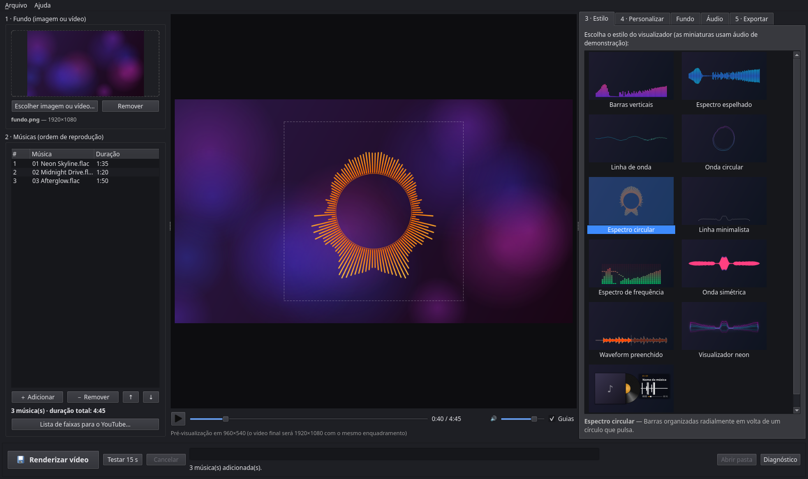
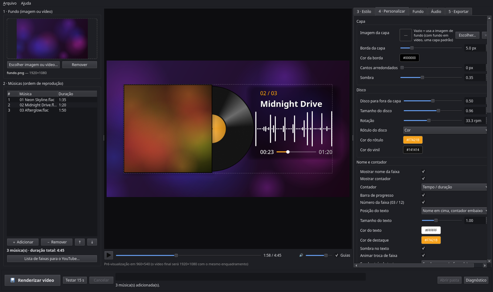
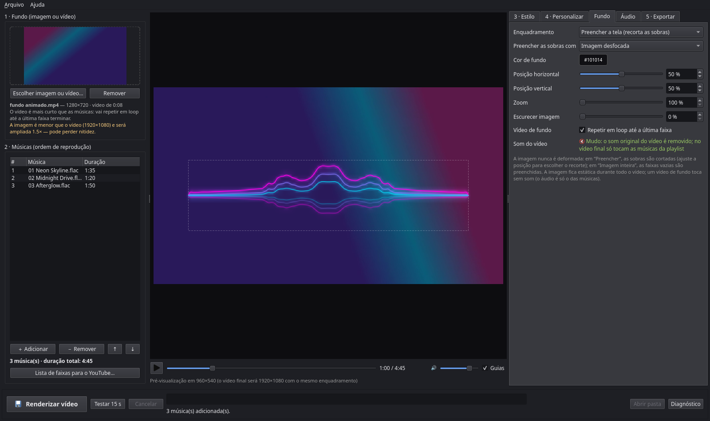
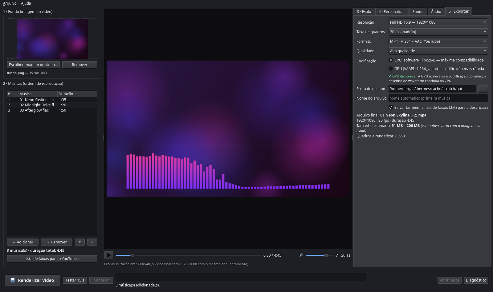
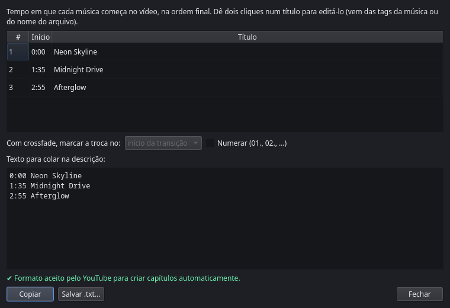
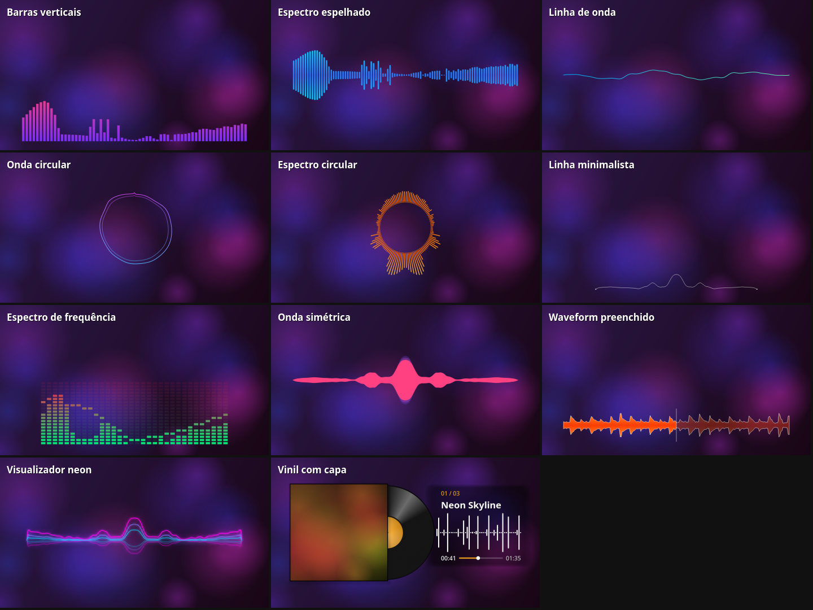
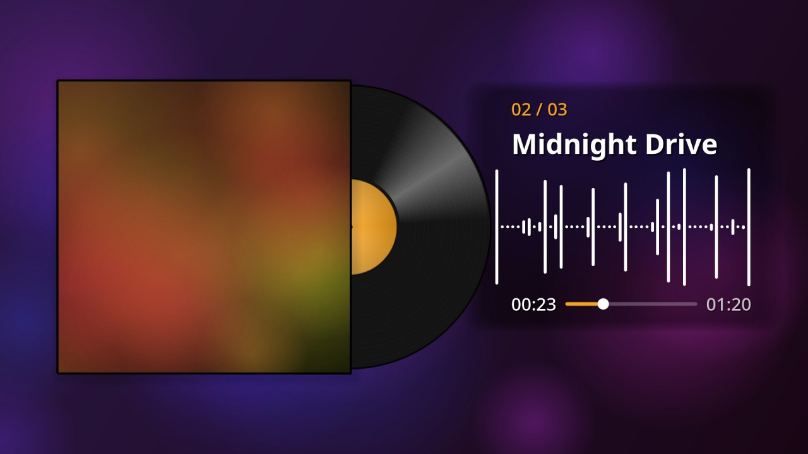

# Wavegen — vídeos musicais com waveform animado

Aplicativo para Linux que junta **uma imagem ou um vídeo + uma ou mais músicas** e gera um
**vídeo completo com visualizador de áudio** sincronizado, pronto para o YouTube
(MP4 · H.264 · AAC). Também exporta só o visualizador, **com fundo transparente**, para usar
como sobreposição no DaVinci Resolve (Free ou Studio).



## Funções

- **Fundo com imagem ou vídeo**: preencher a tela, imagem inteira, recorte, zoom, escurecer.
  Vídeos podem repetir **em loop até a última música terminar**.
- **Playlist**: várias músicas, reordenar, crossfade, intervalo, fades, volume geral.
- **11 estilos de visualizador**, todos personalizáveis (cores, gradiente, tamanho, brilho…),
  com posição e tamanho ajustáveis arrastando na pré-visualização.
- **Vinil com capa**: capa personalizada, disco girando e **nome da faixa com contador**.
- **Pré-visualização com som**, sincronizada com a animação.
- **Lista de faixas com os tempos** pronta para a descrição do YouTube (capítulos).
- **Exportação** em 720p, 1080p, 4K, vertical ou quadrado; CPU ou GPU AMD (VAAPI);
  progresso, tempo restante e cancelamento, sem travar a janela.
- **Projetos salvos** (`.wavegen.json`) para continuar depois.

| Vinil com capa, nome da faixa e contador | Vídeo como fundo, em loop |
|---|---|
|  |  |
| **Exportação** | **Lista de faixas para o YouTube** |
|  |  |

Os 11 estilos (imagens geradas pelo próprio app):



## Instalação

### 1. Dependências do sistema (Arch/CachyOS)

```bash
sudo pacman -S --needed ffmpeg uv portaudio
```

- `ffmpeg`: obrigatório (lê os áudios e vídeos, monta a trilha e codifica o vídeo).
- `uv`: cria o ambiente Python com as bibliotecas (PySide6-Essentials, numpy, sounddevice).
- `portaudio`: som da pré-visualização. Sem ele o app funciona, mas o preview fica mudo.
- Opcional, para usar a GPU AMD: `libva-mesa-driver` (VAAPI). Confira com `vainfo`.

### 2. Baixar o código

```bash
git clone https://github.com/jeffersonmk/wavegen.git ~/Projects/wavegen
```

(ou baixe o .zip pelo GitHub e extraia em `~/Projects/wavegen`; qualquer pasta serve)

### 3. Instalar o app

```bash
cd ~/Projects/wavegen
./scripts/install.sh
```

O script:

1. copia o app para **`~/.config/wavegen/app`**;
2. cria o ambiente Python lá dentro (`~/.config/wavegen/app/.venv`);
3. cria o atalho **Wavegen** no menu de aplicativos, com o ícone.

Depois de instalado, o app não depende mais da pasta do código: ela pode ser movida ou
apagada.

### 4. Abrir

Procure **Wavegen** no menu de aplicativos. Se o ícone não aparecer logo, saia e entre de
novo na sessão.

Opções do script:

| Comando | O que faz |
|---|---|
| `./scripts/install.sh` | instala ou atualiza em `~/.config/wavegen/app` (padrão) |
| `./scripts/install.sh --dest PASTA` | instala em outra pasta |
| `./scripts/install.sh --here` | usa a própria pasta do código, sem copiar (para quem mexe no código) |
| `./scripts/install.sh --remove` | remove só o atalho do menu |

## Atualização

Seus projetos `.wavegen.json`, preferências e cache continuam valendo.

1. **Feche o Wavegen** e espere terminar qualquer renderização.
2. **Traga a versão nova do código**, de um destes jeitos:
   - pelo GitHub:
     ```bash
     cd ~/Projects/wavegen
     git pull
     ```
   - por um arquivo .zip: extraia numa pasta qualquer;
   - mudanças feitas direto na pasta do código: já estão no lugar.
3. **Rode o instalador de novo** a partir da pasta do código novo:
   ```bash
   cd ~/Projects/wavegen
   ./scripts/install.sh
   ```
   Ele substitui os arquivos do app em `~/.config/wavegen/app`, instala bibliotecas novas se
   houver, e reaplica o atalho e o ícone.
4. Abra o **Wavegen** pelo menu. A versão aparece em **Ajuda → Sobre**.

### Dúvidas comuns

- **Preciso apagar o cache?** Não. Ele se refaz sozinho quando muda. Se algo parecer estranho,
  use **Ajuda → Limpar cache de áudio**.
- **O ícone do menu não mudou:** saia e entre de novo na sessão.
- **Deu erro de biblioteca ao abrir:** apague o ambiente Python do app e instale de novo:
  ```bash
  rm -rf ~/.config/wavegen/app/.venv
  cd ~/Projects/wavegen && ./scripts/install.sh
  ```
- **Quero recomeçar do zero:** rode `./scripts/uninstall.sh` (veja abaixo) e instale de novo.

## Desinstalação

Use o script, que pergunta antes de cada etapa:

```bash
~/.config/wavegen/app/scripts/uninstall.sh
```

(ou `./scripts/uninstall.sh` de dentro da pasta do código; funciona igual)

Ele oferece remover, um de cada vez:

1. o atalho e o ícone do menu;
2. o app instalado (`~/.config/wavegen/app`);
3. o cache de trilhas e análises (`~/.cache/wavegen`);
4. as preferências (`~/.config/wavegen/settings.json`);
5. a pasta do código-fonte de onde o app foi instalado (o script avisa se houver projetos
   `.wavegen.json` salvos dentro dela).

Para remover tudo de uma vez: `uninstall.sh --all` (pede uma única confirmação).
O script se recusa a rodar com o app aberto ou renderizando, e só apaga pastas que sejam mesmo
do Wavegen.

Nunca são removidos: os vídeos exportados, projetos salvos fora dessas pastas e os pacotes do
sistema. Se quiser remover os pacotes também (e nada mais os usar):

```bash
sudo pacman -Rs uv portaudio      # o ffmpeg costuma ser usado por outros programas
```

## Executar

- Pelo menu de aplicativos: **Wavegen**.
- Pelo terminal: `~/.config/wavegen/app/.venv/bin/wavegen` (ou com um projeto:
  `… wavegen meu.wavegen.json`).
- Sem interface (renderiza direto):
  `~/.config/wavegen/app/.venv/bin/wavegen render --project meu.wavegen.json --out video.mp4`
  (opcional `--sample INICIO DURACAO` para renderizar só um trecho).
- Lista de faixas no terminal: `… wavegen tracklist meu.wavegen.json`.

De dentro da pasta do código, `uv run wavegen` também funciona.

## Como usar

1. **Fundo** (coluna esquerda): “Escolher imagem ou vídeo…” ou arraste o arquivo para a janela.
   - Imagens: PNG, JPG/JPEG, WebP, BMP e TIFF. Vídeos: MP4, MOV, MKV, WebM, AVI, GIF e outros
     que o FFmpeg leia.
   - Nada é deformado. Na aba **Fundo**: *Preencher a tela* (corta as sobras; ajuste a posição
     do recorte e o zoom) ou *Imagem inteira* (sem cortes; as sobras recebem o fundo
     desfocado ou uma cor). Também dá para escurecer o fundo.
   - **Vídeo de fundo** fica sempre **mudo**: o som original do vídeo é removido e só as
     músicas da playlist tocam (no preview e no vídeo final). Se for mais curto que a
     playlist, a opção **“Repetir em loop até a última faixa”** (aba Fundo, ligada por padrão)
     faz ele recomeçar até o fim; desligada, o último quadro fica parado. Se for mais longo, é
     cortado no fim da última música. O painel avisa qual caso se aplica.
2. **Músicas**: “＋ Adicionar” ou arraste arquivos (MP3, WAV, FLAC, AAC, M4A, OGG, Opus…).
   A ordem da lista é a ordem do vídeo; reordene arrastando ou com ↑ ↓. A duração de cada faixa
   e o total aparecem embaixo. Na aba **Áudio**: em sequência (padrão) ou embaralhado, volume
   geral, crossfade, intervalo entre faixas, fade-in/fade-out.
3. **Estilo**: escolha um dos 11 visualizadores na galeria.
4. **Personalizar**: os controles mudam conforme o estilo (cores, gradiente, opacidade, brilho,
   barras, espessura, raio…), além de posição e tamanho. Também dá para **arrastar o retângulo
   na pré-visualização**: arraste para mover, puxe cantos e bordas para redimensionar,
   Shift = ajuste fino.
5. **Pré-visualização**: ▶ (ou Espaço) toca a trilha real com o visualizador animado. O preview
   usa resolução menor, mas o mesmo código e as mesmas proporções do vídeo final.
6. **Exportar**: resolução, fps, formato, qualidade, CPU/GPU, pasta e nome. O tamanho mostrado
   é uma **estimativa**.
7. **Testar 15 s** renderiza um trecho a partir da posição atual, para conferir o resultado.
   **Renderizar vídeo** gera o arquivo completo, com progresso, tempo decorrido e restante, e
   pode ser cancelado a qualquer momento.

### Vinil com capa (nome da faixa e contador)



- **Capa**: Personalizar → Capa → “Escolher…”. Vazio = usa a imagem de fundo (com fundo em
  vídeo, uma capa padrão). Imagens que não são quadradas são recortadas no centro. Borda,
  cantos arredondados e sombra ajustáveis.
- **Disco**: quanto sai de trás da capa, tamanho, rotação (33⅓/45 rpm ou parado), cor do vinil
  e rótulo em cor ou com a própria capa.
- **Nome e contador**: nome da música que está tocando (das tags, do nome do arquivo ou do
  título editado na Lista de faixas), número da faixa (01 / 12) e contador com barra de
  progresso: tempo/duração, tempo restante ou decorrido. Posição (nome em cima e contador
  embaixo, tudo em cima ou tudo embaixo), tamanho, cores e sombra.
- **Fundo atrás do texto**: escurece só a área do nome e do contador para o texto se destacar
  em capas e fundos claros. *Sombra suave* (esfumada, sem bordas; padrão), *Painel de vidro*
  (cantos arredondados com brilho sutil) ou *Nenhum*, com opacidade e cor ajustáveis. Com “Fundo cobre
  também o waveform” (padrão), nome, waveform e contador ficam num só painel, com o waveform
  por cima, em destaque. O nome entra deslizando a
  cada troca de faixa, e nomes longos diminuem a fonte para caber.
- **Waveform**: reage às batidas (picos, como nos vídeos de referência) ou ao volume.
- Para um efeito de “green screen”, deixe o fundo sem imagem com a cor verde (aba Fundo), ou
  exporte em formato transparente para o Resolve.

### Lista de faixas para o YouTube

O botão **“Lista de faixas para o YouTube…”** (embaixo da lista de músicas, ou no menu Arquivo)
mostra o tempo em que cada música começa no vídeo, na ordem final (considerando intervalo,
crossfade e embaralhamento).

- Dá para editar os títulos (o padrão vem das tags *artista – título* ou do nome do arquivo),
  escolher se a troca durante um crossfade é marcada no início ou no meio da transição,
  numerar, **Copiar** e **Salvar .txt**.
- Na aba Exportar, “Salvar também a lista de faixas” (ligada por padrão) grava
  `<nome do vídeo> - lista de faixas.txt` ao lado do vídeo.
- O app avisa quando a lista não atende às regras de capítulos do YouTube (começar em 0:00,
  3 ou mais faixas, cada uma com 10 s ou mais).

### Projetos

`Arquivo → Salvar projeto` grava um `.wavegen.json` com os caminhos, a ordem das músicas, o
estilo, os parâmetros, a posição e as configurações. A mídia não é copiada para dentro do
projeto. Se algum arquivo foi movido, o app avisa e pede para localizá-lo (e procura os outros
na mesma pasta nova). Preferências, pastas recentes e tamanho da janela ficam em
`~/.config/wavegen/settings.json`.

## Estilos

| Estilo | Dados usados | Desenho |
|---|---|---|
| Barras verticais | espectro (bandas) | barras que crescem da base, do topo ou do centro |
| Espectro espelhado | espectro | barras para cima e para baixo do eixo central |
| Linha de onda | forma de onda (amostras) | osciloscópio contínuo, suavizado |
| Onda circular | forma de onda + volume | onda fechada em círculo que pulsa |
| Espectro circular | espectro + volume | barras radiais em volta de um anel |
| Linha minimalista | espectro | traço fino e discreto |
| Espectro de frequência | espectro | analisador em blocos (estilo LED) com picos |
| Onda simétrica | espectro | forma espelhada preenchida, em camadas |
| Waveform preenchido | envoltória da música | forma de onda rolando como num editor de áudio, trecho futuro mais apagado, linha de reprodução |
| Visualizador neon | espectro | linhas/barras com brilho (glow) |
| Vinil com capa | envoltória (batidas ou volume) | capa personalizada, disco de vinil girando, barras arredondadas que correm a partir do disco, nome da faixa e contador |

Para criar um estilo novo, faça uma subclasse de `Style` em `src/wavegen/styles/`, declare os
`params` (`ParamSpec`) e implemente `draw()`. Ele aparece na galeria e o painel de controles é
gerado automaticamente.

## Formatos de exportação

| Formato | Uso | Observação |
|---|---|---|
| MP4 · H.264 + AAC (padrão) | YouTube | `yuv420p`, BT.709, `+faststart`; *Alta qualidade* = CRF 18 / AAC 320k; *Arquivo menor* = CRF 23 / AAC 192k |
| MOV · ProRes 4444 com alfa | DaVinci Resolve (sobreposição) | sem fundo, áudio PCM 24 bits; arquivos grandes |
| MOV · PNG com alfa | Resolve/edição sem perdas | ainda maior |

Predefinições: 1920×1080, 1280×720, 3840×2160, 1080×1920 (vertical) e 1080×1080 (quadrado);
24, 25, 29,97, 30 (padrão), 59,94 e 60 fps.

**Áudio:** nada é aplicado automaticamente (nem normalização, nem compressão). As faixas são
montadas numa única trilha em 32 bits float a 48 kHz, codificada **uma vez** em AAC. Com uma
única música AAC/M4A, sem volume nem fades, o áudio original é **copiado sem recodificar**.

**Fundo em vídeo:** o FFmpeg decodifica o vídeo e sobrepõe o visualizador durante a
codificação. Fica cerca de 20% mais lento que com imagem (medido: 1 minuto em 1080p em 27 s,
contra 22 s com imagem).

### GPU AMD (VAAPI)

A opção *GPU (VAAPI)* usa `h264_vaapi` para a **codificação** do vídeo. O desenho do waveform
continua na CPU (com vários processos em paralelo), então não é “renderização por GPU”
completa. O app testa a GPU antes de habilitar a opção. Se ela não estiver disponível ou falhar
durante a renderização, aparece uma mensagem clara e a oferta de renderizar de novo pela CPU.
Os arquivos VAAPI saem maiores (~2×) para a mesma qualidade visual.

Medido num PC com RX 9060 XT, trilha de 7min26s em 1080p30: **CPU 2min34s (155 MB)**,
**GPU 1min47s (312 MB)**.

## Solução de problemas

- **Ajuda → Diagnóstico do sistema** mostra a versão do FFmpeg, os encoders, o teste VAAPI e o
  estado do áudio. O botão **Diagnóstico** (rodapé) abre o log técnico com as mensagens
  completas do FFmpeg.
- *“FFmpeg não encontrado”*: `sudo pacman -S ffmpeg`.
- *GPU indisponível*: instale `libva-mesa-driver`, confira com `vainfo` se aparece
  `VAEntrypointEncSlice` para H.264, e se o usuário tem acesso a `/dev/dri/renderD128`
  (grupo `render`). Enquanto isso, use CPU.
- *Preview mudo*: instale `portaudio`; veja o log.
- *Preview com vídeo de fundo engasgando*: é só o preview; o vídeo final não é afetado.
- *Pouco espaço em disco*: o app verifica antes de começar e avisa.
- *Arquivo corrompido ou não suportado*: o arquivo não entra e o motivo é mostrado.
- O cache das trilhas montadas fica em `~/.cache/wavegen` (**Ajuda → Limpar cache de áudio**).

## Para desenvolvedores

```bash
uv run wavegen                                         # roda direto da pasta do código
uv run python -m unittest discover -s tests -v         # 49 testes (~15 s)
QT_QPA_PLATFORM=offscreen uv run python tests/gui_smoke.py PASTA_SAIDA IMAGEM AUDIO...  # interface
QT_QPA_PLATFORM=offscreen uv run python tests/readme_shots.py   # refaz as imagens do README
```

Os testes cobrem: duração da playlist (sequência, intervalo, crossfade), trilha amostra por
amostra igual ao original (sem silêncio extra, sem normalização), fades/volume, sincronia
(cliques caem no quadro certo a 30/60 fps), determinismo (1 processo = N processos, quadro a
quadro), estilos diferentes entre si e reagindo ao áudio, preview proporcional ao vídeo final,
parâmetros do FFmpeg (caminhos com espaços, `-` e `:`), renderização real de MP4 (streams,
duração, áudio = vídeo), fundo em vídeo com e sem loop, nome/contador da faixa certa,
lista de faixas, cancelamento sem arquivo parcial e projeto salvo/carregado.

As imagens em `docs/images/` são geradas por `tests/readme_shots.py` com fundo, vídeo e
músicas sintéticos.

```
src/wavegen/
  ffmpeg.py      FFmpeg/ffprobe: localização, sondagem, teste VAAPI, erros traduzidos
  playlist.py    faixas, configurações de áudio, montagem da trilha única (cache)
  analysis.py    análise do áudio (256 bandas, nível, envoltória) + suavização determinística
  styles/        biblioteca de estilos (base.py, spectrum.py, waves.py, vinyl.py)
  compositor.py  fundo + visualizador num quadro (o mesmo código no preview e na exportação)
  video.py       vídeo de fundo: sondagem, enquadramento, loop, leitura para o preview
  tracklist.py   tempos de cada faixa no vídeo (lista para o YouTube, nome/contador)
  export.py      predefinições, comando de codificação, estimativa de tamanho
  parallel.py    desenho dos quadros em vários processos (memória compartilhada)
  job.py         renderização em processo separado, progresso em JSON, verificação final
  project.py     projeto (.wavegen.json) e preferências
  gui/           interface PySide6: janela, preview interativo, player, widgets
scripts/
  install.sh     instala/atualiza em ~/.config/wavegen/app + atalho no menu
  uninstall.sh   remove tudo (pergunta antes de cada etapa)
```
